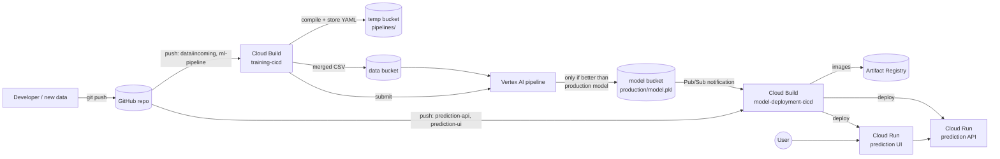

# Will I like this coffee? An MLOps system on Google Cloud

Data Engineering 2026, Assignment 1 (JADS, Tilburg University).

You describe a cup of black coffee (which flavours you notice, and whether temperature, strength,
acidity and body feel "too little / just right / too much"). The model predicts whether you
will like it, meaning a score of 6 or more on a 9-point scale.

The project is about the **MLOps around the model**:

- a versioned Vertex AI training pipeline;
- a containerised prediction API and UI on Cloud Run;
- Cloud Build CI/CD that retrains the model when new data arrives and redeploys the service when a better model is published.

## Architecture



### Training pipeline (`ml-pipeline/`)

| Step | What it does |
|---|---|
| `download-data` | Copies `training_data.csv` from the data bucket |
| `validate-data` | Checks the schema and value ranges, and stops the run on bad data. Builds the label (liked = score ≥ 6) |
| `split-data` | Holds out 20% of the **consumers**, not rows. The same people are never in both train and test, and the split is identical on every run |
| `train-lr`, `train-rf` | Logistic regression and random forest, trained in parallel and scored by 5-fold grouped cross-validation |
| `select-best-model` | Keeps the candidate with the higher cross-validated accuracy |
| `evaluate-vs-champion` | Scores the new model (challenger) and the production model (champion) on the same held-out consumers |
| `deploy-model` (conditional) | Only if the challenger wins: archives it and publishes it as `production/model.pkl` |

### CI/CD pipelines (`cloudbuild/`)

| File | Trigger | Does |
|---|---|---|
| `pipeline-executor-build.yaml` | manual | Builds the custom Cloud Build tool that submits Vertex AI pipelines |
| `training-cicd.yaml` | push to `data/incoming/**` or `ml-pipeline/**`, or manual/scheduled | Tests and compiles the pipeline, stores a versioned YAML, uploads the merged data, then runs the pipeline on Vertex AI |
| `model-deployment-cicd.yaml` | Pub/Sub on a new production model, **and** push to `prediction-api/**` or `prediction-ui/**` | Tests the API against the new model, builds and pushes both images, deploys them to Cloud Run, then smoke-tests the live API |

### Simulating new data

The study ran over three weeks, so the data is split into `data/source/week_1.csv`, `week_2.csv` and `week_3.csv`. The pipeline trains on every file in `data/incoming/`, which starts with week 1 only. To simulate a new batch of tasting data:

```bash
cp data/source/week_2.csv data/incoming/
git add data/incoming && git commit -m "Add week 2 tasting data" && git push
```

## Repository layout

```
builder-tools/pipeline-executor/   custom Cloud Build step that runs a Vertex AI pipeline
cloudbuild/                        the three CI/CD pipeline definitions
data/source/                       original dataset and its weekly batches
data/incoming/                     batches the model is trained on (push here to retrain)
ml-pipeline/                       KFP pipeline definition + tests
prediction-api/                    Flask REST API serving the model + tests
prediction-ui/                     Flask web UI
SETUP_GUIDE.md                     step-by-step Google Cloud setup and demo script
```

## Running locally

```bash
pip install -r ml-pipeline/requirements.txt -r prediction-api/requirements.txt -r prediction-ui/requirements.txt
(cd ml-pipeline && python -m pytest tests)       # runs every pipeline component locally
(cd prediction-api && python -m pytest tests)

# API on :5001 using the test model, UI on :5002
(cd prediction-api && MODEL_REPO=testResources PORT=5001 python app.py) &
(cd prediction-ui && PREDICTOR_API=http://localhost:5001/coffee_predictor/ PORT=5002 python app.py)
```

API example:

```bash
curl -X POST "$API_URL/coffee_predictor/" -H "Content-Type: application/json" \
     --data @prediction-api/testResources/prediction_request.json
# [{"liked": true, "probability": 0.98}, {"liked": false, "probability": 0.28}]
```

## Sources

- **Data:** Cotter, A. R., Ristenpart, W. D., & Guinard, J.-X. (2022). *Consumer preference data for black coffee*. Dryad. https://doi.org/10.25338/B8993H (CC0). Study: Cotter et al. (2021), *Journal of Food Science*, https://doi.org/10.1111/1750-3841.15561.
- **Label definition and feature choice:** Gunning, M., Serantes Laforgue, M. P., Guinard, J.-X., & Tagkopoulos, I. (2026). AI-driven prediction of consumer liking of coffee from sensory data. *npj Science of Food*. https://doi.org/10.1038/s41538-026-00779-7.
- **Code structure:** adapted from the DE2026 course labs by Dr. Indika Kumara (lab2 prediction API/UI, lab3 Cloud Build deployment, lab4 Vertex AI pipeline and pipeline-executor tool).
